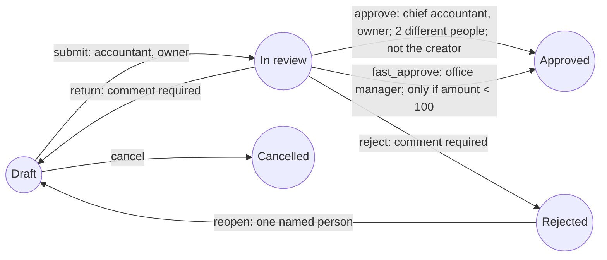

# Approval Workflow

## Purpose

Control how records of an admin-made document type move between states (for example Draft, In review, Approved), who may move them, and what is recorded. The rules run on the server; the screens only show what the server offers.

## Users and permissions

| Who | Can | Enforced by |
|---|---|---|
| Holder of `admin.settings` | Define, change or deactivate a type's workflow; read the role and staff directory used by the editor | Backend (`can('admin.settings')`) |
| Anyone who may view the type | See a record's state, history and the actions offered to them | Backend (`viewPermission`) |
| A person named by a transition (by role, by person, or through a delegation) | Perform that action | Backend, on every action |
| Any staff member | Read their inbox, notifications, delegations and a list of colleagues (id and name) | Backend (own data only) |

## Defining a workflow

Screen: **Document types → Workflow** (`/app/doctypes/<name>/workflow`). API: `GET` and `PUT /api/v1/staff/core/workflows/:doctype` (one workflow per custom type; built-in types are not supported yet).

- **States:** an id, a label, and whether the record is *editable* in it. One state is the initial state.
- **Transitions:** from state, to state, an action id and button label, who may do it (roles and/or named people), how many *different* people must approve (1 to 10), whether a comment is required, whether the creator is barred, and optional conditions.
- **Conditions:** `field operator value` on the record's data (`eq`, `ne`, `gt`, `gte`, `lt`, `lte`, `in`); all must hold. There are no expressions or scripts. A missing or non-numeric value never satisfies `<`, `<=`, `>` or `>=`.
- **Escalation rules:** after N hours in a state, tell certain roles and optionally the people who can act; at most one rule per state.
- **Active flag:** while off, nothing is locked and no actions are offered.

The server refuses (HTTP 422, all problems at once) unknown states, duplicate state names, a transition without an approver, unknown roles or people, conditions on unknown fields, and removing a state that still holds records.

## Acting on a record

Screen: the **Status** panel on a record (buttons for the actions available to you, a comment box, the history). API: `POST /api/v1/staff/core/records/:doctype/:name/actions` with `{ action, comment? }`.

1. The action must be a transition from the record's current state whose conditions hold now, otherwise 422.
2. The caller, or someone who has delegated to them today, must be named by the transition, otherwise 403. If the transition bars the creator, neither the creator nor anyone acting for the creator qualifies.
3. A required comment must not be blank (422).
4. With several approvals needed, each different person's approval is recorded and the record stays put until the last one; the same person cannot approve twice (422). The response says how many are still needed (`pending`).
5. The move is applied only if nobody else moved the record first; the loser gets 409.
6. The move is written to the record's history (who, when, from, to, comment, and on whose behalf) and to the audit chain (`workflow.action`).

While a record is in a non-editable state, editing or deleting it answers 409, even for the owner. Records created before the workflow existed are treated as being in its initial state.

## Notifications, inbox, delegation, escalation

- **Notifications:** when a record enters a state, the people who can act on it are told (except the person who acted and the creator); the creator is told of each change they did not make themselves. `GET /api/v1/staff/core/notifications`, `POST .../notifications/:id/read`.
- **Inbox** (`/app/inbox`, `GET /api/v1/staff/core/workflow/inbox`): records waiting for the caller, with the actions available; shown in the sidebar only on the live API.
- **Delegation:** a person lets a colleague act with their eligibility between two dates (`/api/v1/staff/core/workflow/delegations`). Ending one takes effect at once. It cannot be used to approve the delegator's own records when the transition bars the creator.
- **Escalation:** `npm run workflow:escalate` (function `runEscalations`) tells the configured people once per time a record entered the state. **Nothing schedules it yet.** It must be run from cron or similar.

## Diagram: the workflow used in the acceptance test

## Known limitations

- Only admin-made document types; built-in types (leave, employees, invoices) are not on this engine.
- No "delegate by role", no parallel branches across different states, no timers other than escalation, no automatic approval.
- Escalation is not scheduled; notifications are not shown in the header bell (the bell still reads the mock API); there is no e-mail.
- A notification names approvers as a group: it does not check that the creator is barred from the action.
- Messages from the server for these routes are English only, even in the Arabic interface.
- The history shows what happened after the workflow was added; earlier activity is not reconstructed.
- Two approvers finishing at the same instant: one wins and the other gets 409 although their approval was recorded.
- The role and person lists in the editor come from this organization's roles and staff accounts.

## Technical references

Backend: `backend-mongo/src/core/workflow-rules.ts` (pure rules), `workflow.service.ts`, `workflow.routes.ts`, `workflow.models.ts`, `records.routes.ts`, `scripts/workflow-escalate.ts`. Frontend: `frontend/src/app/features/core/` (`workflow-editor.ts`, `workflow-panel.ts`, `inbox-page.ts`, `workflow-api.service.ts`, `workflow-form.ts`).

## Verification (2026-10-15)

| Behaviour | Evidence |
|---|---|
| Condition rules; definition validation | `npm run workflow:check` (pure part), passed |
| Whole lifecycle: submit, parallel approval, history, locking, comments, reject, return, user-based reopen, conditions, self-approval, concurrency (exactly one of two parallel submits wins), delegation (expired, ended, self-approval through it), inbox, notifications, escalation timing and once-only, removing a used state, inactive workflow, tenant isolation, audit chain | `npm run workflow:check` (HTTP part), passed. Two deliberate breakages (self-approval check removed; state-version guard removed) each made it fail |
| Editor, panel, inbox screens against stubbed HTTP | `workflow-pages.spec.ts`, `workflow-form.spec.ts` |
| Whole path in Chrome on the real API with three users: build the workflow in the editor, a server refusal shown, accountant submits and the form locks, the accountant cannot approve their own, the chief accountant finds it in the inbox and approves with a comment, the creator is notified and marks it read, a delegation is added and ended, a locked record refuses an edit | A one-off Playwright run (not committed to the repository) |
| Not exercised in a browser | Parallel approvals (2+), conditions, escalation rules in the editor, the Arabic layout of the editor, `npm run workflow:escalate` against a real database |
